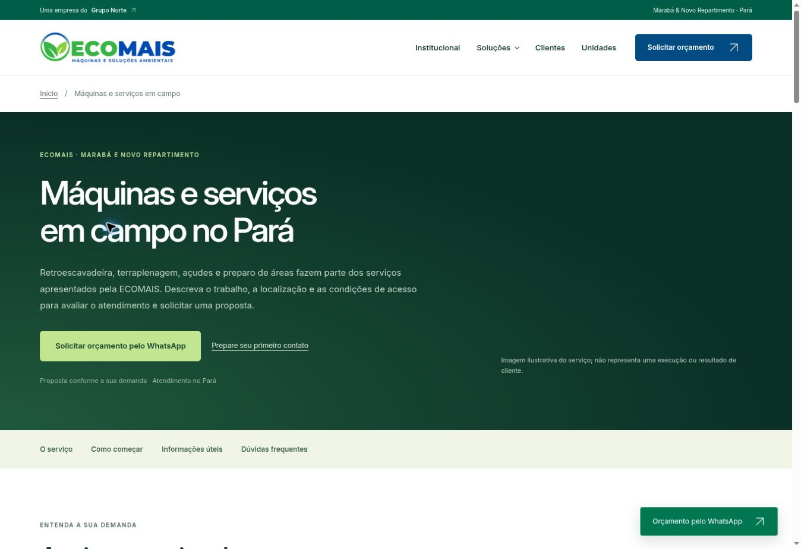

# Expansão do portfólio — revisão antes da publicação

Status: preparado para aprovação. Não publicar ou incorporar à main sem aprovação explícita de Josué.

## Páginas

| Serviço | Caminho |
| --- | --- |
| Embargos ambientais | `/embargos-ambientais-para/` |
| Regularização agronômica | `/regularizacao-agronomica-para/` |
| Pecuária e confinamentos | `/pecuaria-confinamentos-para/` |
| Segurança do trabalho | `/seguranca-trabalho-para/` |
| Medição de ruído ambiental e industrial | `/medicao-ruido-para/` |
| Máquinas e serviços em campo | `/maquinas-servicos-campo-para/` |

As seis páginas reutilizam o modelo de licenciamento, a identidade institucional, os contatos e os recursos locais. Cada página inclui descrição, frentes de atendimento, informações para orçamento, cinco perguntas frequentes e mensagens específicas de WhatsApp. Menus desktop/móvel, cartões e catálogo estruturado da home apontam para as páginas. Os destaques fotográficos de ruído e máquinas também apontam diretamente para seus serviços.

## Base editorial

Fonte: cartões `servico-4` a `servico-9` de `index.html`, no commit publicado `79c48bc9a73cdbb45e9a7d97928b06cb8db2f6fd`. O escopo se limita a análise e apoio técnico para embargos; orientação agronômica; regularização ambiental de pecuária/confinamentos; programas e laudos de segurança; avaliação de ruído com sonômetro; retroescavadeira, terraplenagem, açudes e preparo de áreas.

Não foram acrescentados registros profissionais, certificações, equipamentos específicos de medição, promessas de aprovação, prazos de órgãos públicos, resultados produtivos, serviços jurídicos, veterinários ou dosimetria. As imagens já existiam no site e são ilustrativas, conforme `assets/visual-notes.md`; as legendas deixam isso explícito.

Cada página tem title/description exclusivos, canonical, Open Graph, Service, WebPage e BreadcrumbList. FAQs são conteúdo HTML acessível, sem promessa de rich results. O sitemap passa de quatro para dez URLs (home e nove serviços). A página auxiliar de contatos permanece preservada, fora desse conjunto de páginas comerciais.

## Verificação

- `python3 scripts/check_site.py`: 2.349 verificações aprovadas em dez páginas, incluindo links, âncoras, identidade, sitemap, entidades e catálogo.
- `node --test scripts/test_app.cjs scripts/test_conversion.cjs`: 13 testes aprovados.
- `node --check app.js` e `node --check operations.js`: aprovados.
- `PYTHONPATH=/tmp/ecomais-css-qa python3 scripts/check_styles.py`: aprovado, tinycss2 1.4.0 (dependência de QA, não publicada).
- `git diff --check`: aprovado.
- Navegador: navegação pelo menu para as seis novas páginas, cinco FAQs em cada página, abertura de FAQ, fotografias carregadas; layouts de 320 e 390 pixels e menu móvel com navegação para embargos.
- Nenhuma mensagem de WhatsApp enviada; links e mensagens foram conferidos sem contato externo.

O verificador antigo falhava antes das alterações: incluía contatos como se fosse página de serviço, esperava quatro páginas e usava baseline anterior ao redesenho publicado. A referência foi atualizada ao commit publicado, preservando os controles de conteúdo, formulário e assets. Orçamentos agora refletem os recursos existentes: 305 kB para HTML/CSS/JS/logo/fonte, 400 kB separados para fotografia, 10 kB para app.js e 100 kB para todo o CSS. Nenhuma biblioteca de produção foi adicionada. O mock do teste de foco foi corrigido para representar `document.activeElement` como null, em vez de undefined.

O script pós-publicação `check_live.py` lê as rotas do sitemap; sua execução fica para depois da aprovação e implantação, pois as novas URLs ainda não estão públicas. Revisão visual não equivale a auditoria completa de acessibilidade ou medição de Core Web Vitals.

