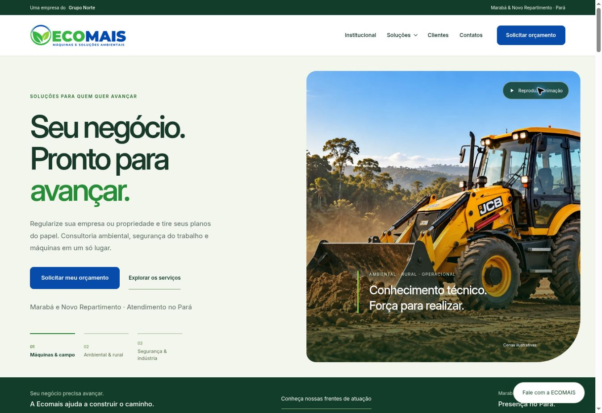
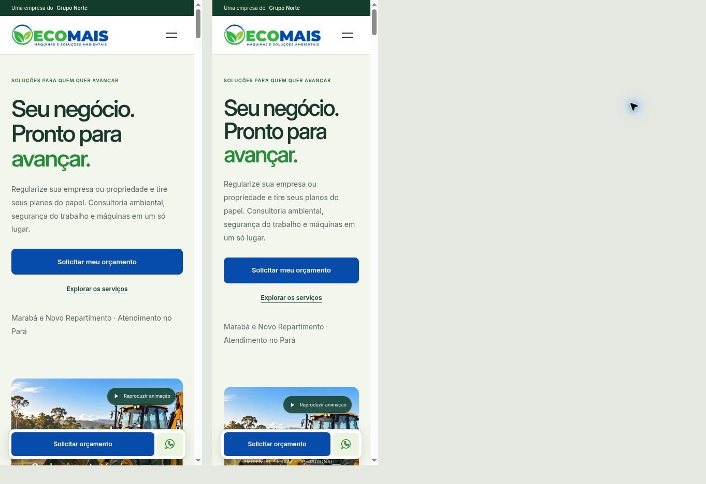

# Reforma comercial da ECOMAIS

## Resultado

Nova direção visual para a página inicial, as nove páginas de serviços e a página de contatos. Verde predominante, azul institucional nos botões comerciais, fundo claro, tipografia Inter local e fotografias ilustrativas já aprovadas no site.

A abertura combina a mensagem “Seu negócio. Pronto para avançar.” com imagem operacional em destaque. O caminho de contratação mantém seleção de serviço, escolha de unidade e mensagem de WhatsApp. Os dois telefones, endereços, catálogo, logos de clientes e textos técnicos permanecem preservados. Nenhuma qualificação, resultado, prazo de atendimento ou atividade nova foi inventada.

Os menus, cartões, seções de necessidades, apresentação fotográfica, prova social, etapas, FAQ, rodapé e formulário receberam uma composição coerente. As setas ornamentais das páginas de serviços e contatos foram removidas. No celular, uma barra fixa permite solicitar orçamento e acessar WhatsApp. A página de contatos acompanha a identidade e mantém telefone/WhatsApp separados por unidade.

A animação da abertura passa a ser opcional, para manter a mensagem estável ao chegar. O visitante pode escolher a área, reproduzir e pausar os vídeos silenciosos. Movimento reduzido continua respeitado. Os três arquivos de estilos antigos foram substituídos por `brand.css` e `commercial.css`, com a identidade compartilhada separada do CSS da home, reduzindo o carregamento nas páginas de serviços.

## Verificação

- Verificador local de páginas, metadados, sitemap, catálogo, recursos e links aprovado.
- 13 testes de comportamento aprovados: menus, filtros, seleção de serviço, formulário, unidades, cópia alternativa e botão de contato.
- Sintaxe JavaScript e CSS aprovada; diferenças Git sem erros de espaços.
- Navegador: desktop e molduras de 390/320 pixels (área útil 375/305 devido à barra de rolagem), sem transbordamento horizontal observado no celular estreito.
- Menu móvel abre/fecha e navega; filtro de máquinas mostra a categoria correta; solicitar proposta preenche o serviço; Continuar abre a etapa de contato.
- Destaque de ruído navega para a página correspondente; página de contatos revisada; seletor de cenas, reprodução silenciosa e pausa do vídeo verificados.
- Nenhuma mensagem enviada. Testes não equivalem a medição de conversão, auditoria completa de acessibilidade ou Core Web Vitals.

## Prévia

## Publicação

Preparado em branch separada. Aguardar aprovação explícita do usuário antes de incorporar à main e acionar o GitHub Pages. A autorização da PR #4 se referia à expansão anterior do portfólio, já publicada.
